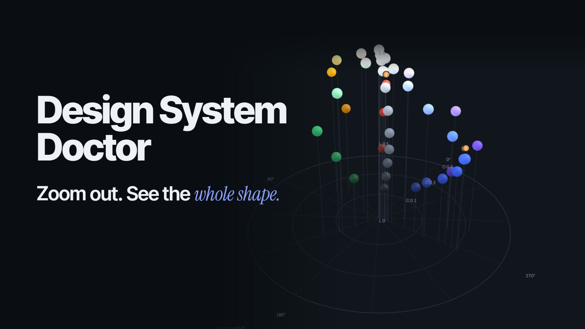
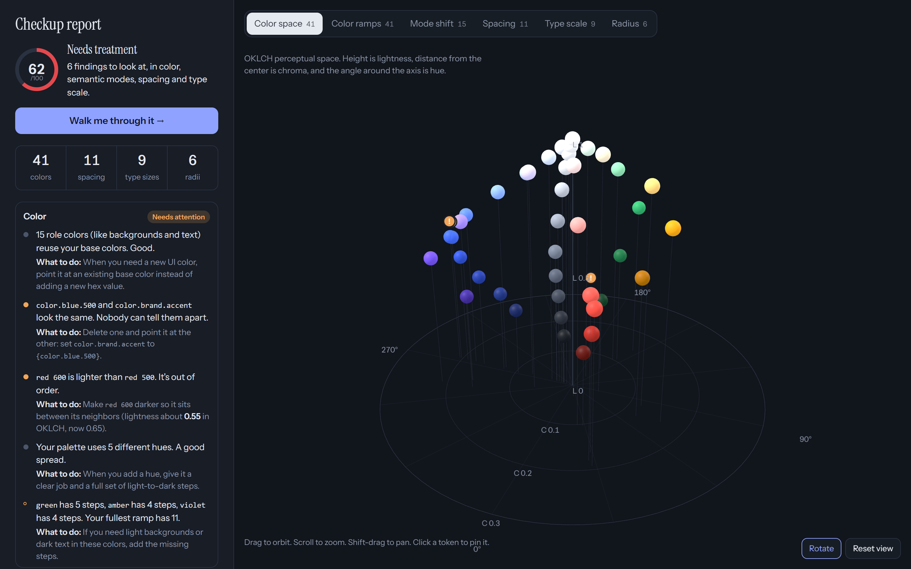
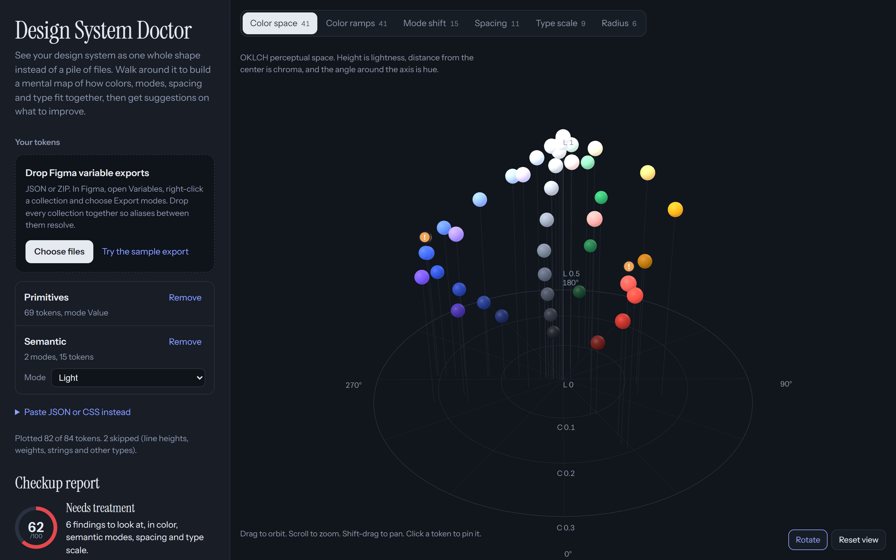
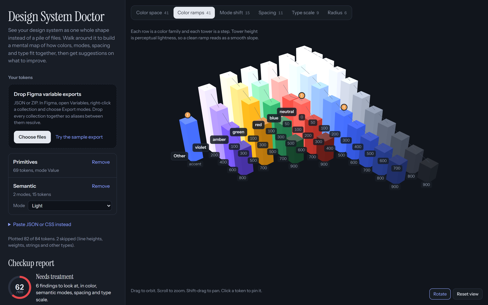
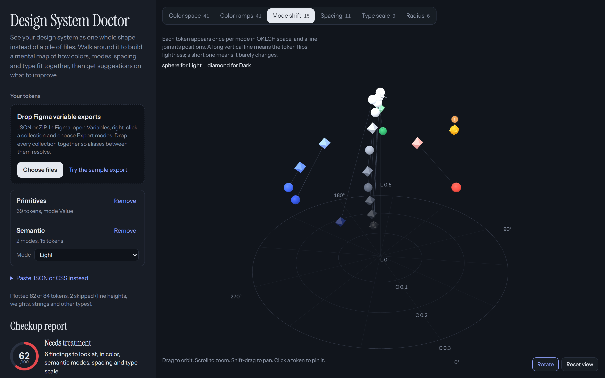
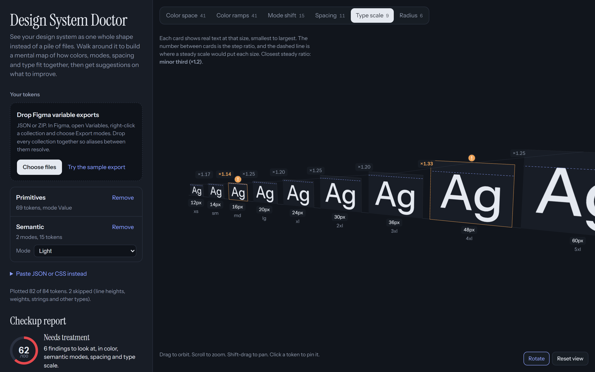

# Design System Doctor

**See your design system as a whole, then learn what to improve.**

Design systems usually live in a pile of files: color variables here, spacing there, type and dark mode somewhere else. Design System Doctor brings them together into one 3D shape, so you can:

1. **See the whole system at once**, not a bunch of separate files.
2. **Build a mental map** of how colors, modes, spacing, type and radius relate.
3. **Get suggestions** on what's missing or off, and how to fix it.

**[Open Design System Doctor →](https://raghurai.github.io/design-system-doctor/)**

[](docs/launch-video.mp4)

*Watch the 24-second launch video (click the image).*



---

## Three minutes

Not long ago I was asked to explain our design system in three minutes.

It should have been easy. I knew the system well. But every way I tried to show it fell apart. A swatch grid showed colors without showing how they related. A token table was accurate and impossible to take in at a glance. Spacing, type, radius, light mode and dark mode each lived in a different place, and the system only made sense if you already held all of it in your head.

That's when it clicked. A design system isn't a list. It has a **shape**: colors that cluster or leave gaps, ramps that climb smoothly or stumble, scales that step evenly or drift. Lists hide that shape. You can only see it when you put the values in space.

So I built Design System Doctor.

## What you see

Drop in your tokens and the system turns into something you can walk around.

**Color space.** Every color sits in OKLCH, a perceptual color space. Height is lightness, distance from the center is chroma, and the angle is hue. Clusters, gaps and near-duplicates become visible right away.



**Color ramps.** Each color family becomes a row of towers whose heights follow perceptual lightness. A good ramp reads as a smooth slope. A step that's out of order is buried in a token list and impossible to miss here.



**Mode shift.** Each semantic token appears once per mode, joined by a line. Light and dark backgrounds trace long vertical paths as their lightness flips. A token that never moves stands out immediately, sometimes because it's intentional and sometimes because nobody remembered to set its dark value.



**Spacing, type scale and radius.** Spacing becomes bars, with values off the 4px grid highlighted. Font sizes become a staircase of real text, with the ratio between each step shown and uneven steps outlined. Each corner radius is drawn on a real tile, so you can feel the difference between 8 and 12.



## Visual discipline

Seeing the shape changes how you take care of a system. A ramp that stumbles, two colors only a hair apart, a spacing value someone added under deadline: these are easy to wave through in a spreadsheet and hard to ignore once they're in front of you.

Design System Doctor points them out, marks them with an orange **!** right on the shape, and suggests a fix for each one:

- Near-duplicate colors (ΔE in OKLab under 0.015)
- Color ramps whose lightness steps out of order
- Spacing values off the 4px grid, and tokens that share a value
- Type scales that drift from a consistent ratio, with the closest named interval
- Semantic tokens that keep the same value in every mode
- Missing pieces: no red, green or amber for errors, success and warnings; ramps much shorter than the rest; big jumps in the spacing scale; too few type sizes; no dark mode

Each finding comes with a concrete suggestion, such as the lightness a ramp step should move to, the grid value to round a spacing token to, or the sizes a steady type scale would use. Hover a marked token in any view to see its suggestion there.

## The checkup

Drop in your tokens and you also get a checkup report: a score out of 100, a one-line verdict, and the findings counted by area (color, semantic modes, spacing, type scale). The sample export scores 62 and comes back as *Needs treatment*, with six findings.

Every finding is written in plain language and ends with a **What to do**: delete the near-duplicate and point it at the other token, make `red 600` darker so it sits between its neighbors, round `spacing.card-inset` to 32px, or use the exact sizes a steady scale would. If you'd rather not read the whole list, press **Walk me through it** and go through the findings one round at a time.

It's meant for audits, for design and engineering reviews, and for the next time someone gives you three minutes.

## Bring your own system

1. In Figma, open **Variables**.
2. Right-click a collection and choose **Export modes**. Export every collection, including primitives, so aliases between collections resolve.
3. Open [Design System Doctor](https://raghurai.github.io/design-system-doctor/) and drop all the files onto the page (JSON or ZIP).

Collections appear in the side panel. Any collection with more than one mode gets a mode picker and shows up in Mode shift.

Nothing is uploaded. Files are read in your browser, and your last session is kept in local storage so it's there when you return.

**Does it read Figma variables directly?** Not yet. Today it reads exported JSON, which works on every Figma plan without signing in. A companion Figma plugin and live sync for Enterprise teams are on the roadmap.

### Other formats

You can also drop or paste W3C Design Tokens (DTCG), Style Dictionary, Tokens Studio, flat JSON, or CSS custom properties. Aliases such as `{color.blue.500}` and `var(--color-blue-500)` are resolved. For Figma number variables, scopes decide whether a value is spacing, radius or type, and names are used as a fallback.

Want to try it first? Click **Try the sample export** in the app, or use the files in [`samples`](samples). They include a few deliberate flaws so you can watch the checks catch them.

## Getting around

- Drag to orbit, scroll or pinch to zoom, shift-drag to pan
- Hover a token for details, click to pin them
- With the canvas focused, arrow keys orbit, `+` and `-` zoom, and `Esc` closes the pinned tooltip

## Run it locally

Design System Doctor is a single HTML file with no build step.

```sh
git clone https://github.com/raghurai/design-system-doctor.git
cd design-system-doctor
python3 -m http.server 8000
```

Open http://localhost:8000. It loads [three.js](https://threejs.org) r128 and [JSZip](https://stuk.github.io/jszip/) 3.10.1 from cdnjs, and Instrument Sans and Instrument Serif from Google Fonts.

## What's next

- A companion Figma plugin that exports every collection and mode in one click
- Live sync through the Figma Variables REST API for Enterprise plans
- Contrast pairing between text and surface tokens across modes

If you try it on your own system, I'd love to hear what shape it turned out to be. Issues and ideas are welcome.

## License

[MIT](LICENSE) © 2026 Raghurai Kulkarni
